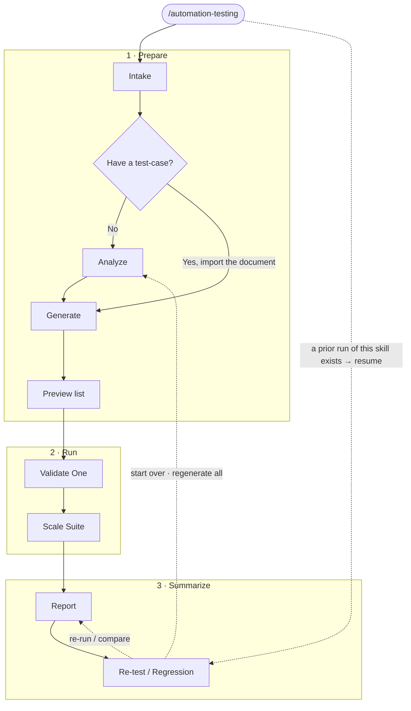

# automation-testing — QA Automation Testing Skill

A single, self-contained QA automation skill that runs on any project or tech
stack. Say **"automation testing"** and it detects what to test, generates
source-traceable test cases, runs them with evidence capture, and produces
matching **Excel + Word** reports — pausing at an approval gate after every stage
so you stay in control.

> This README is the doc you read first. For the full orchestrator behavior
> (detection matrices, gate state machine, and the complete field reference) see
> [`SKILL.md`](./SKILL.md).

## Why this skill

QA automation is usually scattered across brittle scripts, manual test-case
sheets, and one-off report tooling. This skill packages the whole loop into one
copyable folder with the human kept in the loop:

- **One folder, zero external dependencies** — copy `.kiro/skills/automation-testing/`
  into any project and it works (bundles its own Excel/Word reporting engine).
- **Scope-adaptive** — auto-detects UI / API / unit-integration and picks a run
  level (smoke / focused / full); falls back to testing a live URL when there is
  no app in the project.
- **Approval gates everywhere** — stops and asks (Change? / Next?) after each
  stage; never runs the whole thing blind.
- **Evidence by default** — a screenshot per test case (captured at the end of
  each case) plus a slow-motion video (slowMo 1000ms), foldered by pass/fail.
  Captures run at **three responsive viewports** (desktop / tablet / mobile) at
  2× scale for crisp images, are **validated and re-captured** if blank/distorted,
  and support **pixel-variance** visual comparison (`toHaveScreenshot`).
- **Reports that never drift** — one data model → the `Test_Case_Summary` workbook +
  the `Application_Testing_Report` document, with the real screenshot embedded inline
  in the workbook. (No separate HTML report — the two documents are the deliverables.)
- **Full traceability** — every test case maps back to a `source_reference` and a
  `user_story_id` (the feature/function it verifies).

## Quick Start

### 1. Install (copy the folder)

```bash
# into any project
cp -r .kiro/skills/automation-testing /path/to/your/project/.kiro/skills/
```

Or use the template installer (also copies the workflow guide + Playwright MCP
config):

```bash
./install.sh /path/to/your/project
```

Dependencies: **Python** `openpyxl` + `python-docx` (reporting) — always required.
**Node is optional** — needed only when the chosen UI driver or the JS health check
is Node-based (Playwright default / Cypress / WebdriverIO). The UI layer is
**tool-agnostic**: the skill reuses the project's existing e2e driver
(Cypress/WebdriverIO/Selenium/Puppeteer) and falls back to a bundled **Playwright
default** only when none exists. A project testing only API/Unit needs no Node.

### 2. Your first run

Just tell the agent what you want — no flags, no setup:

```
automation testing
```

The skill inspects the project, proposes the QA layers + scope, and walks the
lifecycle one stage at a time, stopping at each approval gate.

### 3. Commands

| Command | What it does |
|---|---|
| `automation testing` / `qa test` | Activate the skill (auto-picks where to start) |
| `start` | Begin a fresh run from the top (Intake/Scope-detect) |
| `test one` | Validate a single test case (prove capture setup) before scaling |
| `scale` | Run the full suite of existing test cases sequentially |
| `rerun` | Re-execute existing specs without regenerating and diff vs. last run |
| `retest ui` / `retest api` / `retest unit` | Re-test **one domain only** (scoped rerun — reuse cases, run that layer, diff baseline) |
| `status` | Show current lifecycle position + latest results (read-only) |

## Cross-Platform Usage

This skill is tool-agnostic. The instructions (`SKILL.md`) and bundled scripts
work on any AI coding assistant that can read markdown instructions and execute
shell commands — and because every report is rendered by the bundled
Reporting_Engine (one canonical command, `scripts/build_reports.py`), **every
tool produces the same `doc/` output** from the same `data/test_cases.json`.

### Kiro (native)
```bash
cp -r automation-testing/ <project>/.kiro/skills/automation-testing/
```

### Amazon Q
1. Add the skill folder to your allowed local folders (Settings → My Computer)
2. Tell the agent: "automation testing" — it will read SKILL.md and follow the workflow

### Other AI Tools (Claude, Cursor, Windsurf, etc.)
1. Paste or attach `SKILL.md` as system instructions / project rules
2. Ensure the agent can run Python (for reporting) and Node.js (for Playwright)
3. The `scripts/` CLI tools work standalone — no proprietary API needed

### Standalone CLI (no AI agent)
```bash
pip install -r requirements.txt
# Build every report deterministically from data/test_cases.json into doc/
python scripts/build_reports.py qa-automation-testing
```

## Workflow Overview

The skill library runs as **three phases / seven stages** (Intake and Analyze are
separate skills), with an approval gate between every stage. Two non-gated helpers
assist: **`automation-testing-evaluate`** (activated *by* Report to compute the
evaluation + author the narrative) and **`automation-testing-datamock`** (consulted
during Intake/Analyze/Generate/Scale to resolve the test-data source + environment).
Here is the high-level flow; the details for each stage are in the table below.



**Stage details**

**Phase 1 · Prepare**

| # | Stage | Skill | What it does | Approval gate |
|---|---|---|---|---|
| 1 | **Intake** | `automation-testing-intake` | Reply in the user's language; quick scan → **ask only the gaps** (target repo/URL, sources, existing test cases?, scope, access, report metadata) | Inputs captured? |
| 2 | **Analyze** | `automation-testing-analyze` | **Deep project analysis** using intake inputs → map QA layers, derive end-to-end coverage, scope level, risk | Scope/coverage correct? |
| 3 | **Generate** | `automation-testing-generate` | Build the test-case **preview list** (status blank), or **import** an existing doc (map → confirm, keep ids, gap-fill only with approval) | Review the list |

**Phase 2 · Run**

| # | Stage | Skill | What it does | Approval gate |
|---|---|---|---|---|
| 4 | **Validate One** | `automation-testing-validate` | Run **one** case first to prove capture (screenshot + slow-mo video), **auto-fix a flaky script up to 3 rounds**, then **summarize** how it went | Setup/evidence OK? |
| 5 | **Scale Suite** | `automation-testing-scale` | Run **all** cases sequentially **in TC-id order**, announcing per-layer status (UI / API / Unit); **auto-fix a flaky script up to 3 rounds per case** | Results/evidence OK? |

**Phase 3 · Summarize**

| # | Stage | Skill | What it does | Approval gate |
|---|---|---|---|---|
| 6 | **Report** | `automation-testing-report` | First runs the **`automation-testing-evaluate`** helper (aggregate run data → correct evaluation → author narrative into `report_meta.json`), then summarizes results into **test_cases.xlsx + .docx** (status, evidence, pass/fail summary, RTM, defect log) | Reports OK? |
| 7 | **Re-test / Regression** | `automation-testing-rerun` | Re-run the **same** specs (no regenerate) and **diff vs the baseline run** | Regressions reviewed? |

**At every gate** the skill first **summarizes what just happened** (counts,
pass/fail, problems found), lists any **questions** clearly if it needs input, and
then offers two explicit choices — **Proceed → next step** or **Change** (revise
the current step). It never crosses a gate on its own.

At every gate: **Next** proceeds one stage, **Change** revises the current stage
and re-asks. The skill never crosses a gate on its own.

## Scope-Adaptive Workflow

Stage 1 is **not** a fixed detector. The skill first **asks your language
(Thai/English)**, then **analyzes the project itself** (manifests, source layout,
routes, API specs, docs, existing test cases), **reports what it found and states
exactly what information is missing**, and only then asks you for those gaps and
**proposes** the QA layers, scope level, and target — which you can **confirm, add
to, remove, or override**. The markers below are just common hints (examples, not
exhaustive); the skill infers beyond them and asks you whenever it is unsure.

**Intake — language first, then only the gaps**

The skill **asks your language (Thai / English) first**, then analyzes the project
and **reports what's missing** before asking. It only asks for what it could not
determine: target (repo or live URL) · project type/stack · sources of truth
(requirements / user stories / API spec / existing test cases) · scope & focus
(which modules, how deep) · access/login needs · constraints · report metadata. It
skips anything the workspace already answers and offers its analyzed guess as the
default.

**Layer hints (examples, not a fixed list)**

| Markers (any match) | Suggests |
|---|---|
| Web app code — `index.html`, `package.json` w/ react/vue/svelte/next/angular, `*.{jsx,tsx,vue}` | **UI** |
| API defs — `openapi`/`swagger.{json,yaml}`, route files, `*.proto`, GraphQL schema | **API** |
| Test framework — jest, vitest, mocha, pytest, go test, phpunit, junit, rspec, cargo test, … | **Unit-Integration** |
| No app in the repo | test a **live URL** instead |

You confirm the final set — you can add a layer the analysis missed (e.g. mobile,
Rails/Django, .NET) or drop one you don't want. A layer you don't confirm is never
run.

**Scope level** (always exactly one)

| Project state | Level |
|---|---|
| ≥ 2 layers **and** rich sources (≥ 10) | `full` |
| 1–2 layers, moderate sources (≥ 3), prior run exists | `focused` |
| Otherwise (single layer / few sources / first run) | `smoke` |

**Entry stage** is auto-selected from what already exists, so re-invocations
resume in the right place: no reports/specs → Intake · reports w/o specs →
Generate · reports + specs + results → Re-run/Regression · reports + specs w/o
results → Scale Suite · no app markers → Intake in External_URL_Mode.

## Key Behaviors

- **Approval gates (Change? / Next?)** — after each stage the skill stops and
  asks; **Change** re-presents the same stage, **Next** advances exactly one
  stage. It pauses until you answer and never auto-advances.
- **Traceability** — every test case carries a non-empty `source_reference` + a
  `source_origin` classification and a `user_story_id` (column **B**, right after
  `id`) mapping it to its feature/function.
- **Reports, guaranteed parity** — all reports come from one
  `test_cases.json` model, so they never drift. The **XLSX** is a **standard,
  industry-style QA workbook** — **Info / Summary / per-type sheets (UI-E2E ·
  UI-Functional · API · Unit-Integration) / TestCases / Traceability /
  DefectLog / History_*** — where the per-type sheets are clean, filtered views
  of the one model and `status` lives in a **computed** column (currently **R**)
  that every Summary formula references; the **DOCX** is a **standard, sectioned
  Test Execution Report** (cover, approval, revision history, TOC, sections 1–8,
  including a defect table and an RTM). No separate HTML report is produced — the
  XLSX + DOCX are the deliverables. Parity verifies every test
  case **id + status** appears across both formats. Report metadata
  (project/company/version/environment/accounts) comes from an optional
  `report_meta.json` collected at Intake; missing fields render as "—". At the
  Report stage the **`automation-testing-evaluate`** helper **authors each DOCX
  section from the actual analysis and results** — real prose plus a real
  evaluation (pass rate, derived quality level, key findings, recommendations)
  written into `report_meta.json` under `narrative` — so the document carries
  genuine project content, not placeholders (unauthored fields fall back to
  computed defaults). When no real source document exists it fills every section
  using the report engine's built-in fallback layout and prose.
- **QA logs, Dev fixes** — the skill **auto-fixes only the test scripts**
  (flaky selectors/timing, ≤3 attempts). A genuine **product defect** is **never
  patched in application source code** by the skill; it is **logged to the
  DefectLog** (assigned to the Developer, with an optional suggested root cause)
  and **re-tested after the dev fixes it**. Defect lifecycle:
  `New → Assigned → In-Progress → Fixed → Retest → Verified → Closed` (Reopen if
  a retest still fails).
- **Evidence per test case** — sequential run (`workers:1`) captures one
  screenshot at the **end of each case** (foldered `pass/` / `fail/`, named by
  test-case id) plus a slow-motion video. The **real image is embedded** in both
  reports (`screenshot` column **Y**), while `screenshot_path` (column **Z**)
  keeps the path as a text note.
- **Self-contained** — all scripts and templates are referenced by skill-relative
  paths; no dependency on any other skill.
- **Standards-aligned** — **risk-based ordering** (Critical → High → Medium → Low
  in Scale Suite, derived from priority × module criticality when not set), an
  **environment health check** before any run (skips execution if the target is
  unreachable), and **test-data management** (data-driven variants, setup/teardown
  isolation, cleanup) — per ISO 29119 / ISTQB TAE.

## Outputs

```
<project>/qa-automation-testing/
├── data/                    # all .json
│   ├── test_cases.json      # single source of truth (the model)
│   ├── report_meta.json     # optional report metadata (project/company/version/env/accounts)
│   └── .video-map.json      # runtime map (written per-test, read by teardown)
├── doc/                     # human-facing reports (system-named from report_meta.system_name)
│   ├── Test_Case_Summary - <system>.xlsx          # ONE Excel workbook — Info → Summary → TestCases → per-type → per-device (Desktop/Tablet/Mobile) → Traceability → DefectLog
│   └── Application_Testing_Report - <system>.docx # Word — consolidated Test Execution Report (all devices)
├── Backup/<timestamp>/      # previous doc/ set, saved automatically before a Re-test
├── scripts/                 # generated specs + copied helpers / teardown / health-check
└── results/
    ├── screenshots/{pass,fail}/TC_XXX__{desktop|tablet|mobile}.png   # one per test case × viewport
    ├── videos/{device}/{pass,fail}/TC_XXX.webm                       # per-TC clip, recorded at real viewport size
    ├── videos/{device}/full_run__{device}.webm                       # full end-to-end run video per device
    ├── videos/{device}/full_process__{device}__positive.webm         # full E2E POSITIVE (happy-path) journey per device
    ├── videos/{device}/full_process__{device}__negative.webm         # full E2E NEGATIVE (error-path) journey per device
    ├── visual-baselines/                                             # pixel-variance baselines (toHaveScreenshot)
    ├── html-report/                                                  # Playwright HTML report
    └── runs/<timestamp>/                                             # per-run snapshot (copies data/ + doc/) — baseline for Re-test
<project>/playwright.config.js               # workers:1 · slowMo · video@viewport-size · 3 viewports · deviceScaleFactor 2
```

## Layout

```
.kiro/skills/automation-testing/
├── SKILL.md              # Skill_Orchestrator — full behavior, matrices, field reference
├── README.md             # this file
├── LICENSE.txt
├── scripts/              # Reporting_Engine (Python): build_reports (canonical),
│                         #   report_model, report_xlsx, report_docx,
│                         #   parity, regression_diff, runs, paths, scope, gate
└── reference/            # reference & developer guides
    ├── FIELD_REFERENCE.md      # model fields, report_meta keys, report contents, parity
    ├── CLI_REFERENCE.md        # all script commands
    ├── DOMAIN_CONTRACT.md      # how to add a new test type (domain) without editing stages
    └── SKILL_DEV_STANDARD.md   # house dev standard + review checklist
```

> The report layout + per-section fallback prose are built into the engine (no separate
> template files). Domain-specific capture assets live with their domain — e.g. the
> Playwright templates are owned by `automation-testing-domain-ui/assets/templates/`.

## Two axes — stages × test domains

Testing is organized on two axes so it stays generic **and** extensible:

- **Lifecycle stages** (`-intake … -report … -rerun`) — the *process*; generic, no
  hard-coded test type.
- **Test domains** (`-domain-ui` / `-domain-api` / `-domain-unit`) — the *capabilities*;
  each owns one test type (detect / generate / execute / evidence / report mapping) and
  its own assets. Add a new kind of testing by adding one domain skill — see
  `reference/DOMAIN_CONTRACT.md`. **No stage edits, output unchanged.**

**What this skill tests**

| Test type | Domain skill | Now |
|---|---|---|
| UI E2E (journeys, positive + negative) | `automation-testing-domain-ui` | ✅ |
| UI Functional (screen / component) | `automation-testing-domain-ui` | ✅ |
| API (REST / GraphQL / gRPC) | `automation-testing-domain-api` | ✅ |
| Unit / Integration (native runner) | `automation-testing-domain-unit` | ✅ |
| Performance / Security / Accessibility | *(planned)* | 🔒 |

## License

Proprietary. See [`LICENSE.txt`](./LICENSE.txt) for complete terms.
